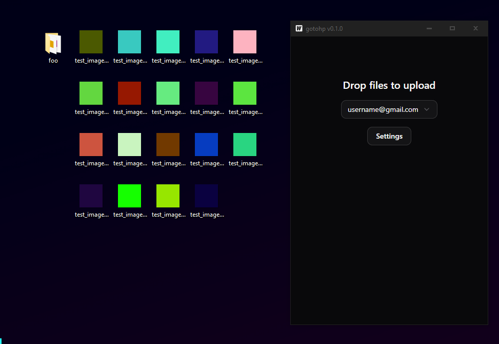

# gotohp



Unofficial Google Photos Desktop Client with automatic background backup, folder watching, and unlimited storage uploads.

---

## ✨ Features

- **Unlimited Uploads**: Upload photos and videos without consuming your Google Drive quota (can be toggled in settings).
- **Automatic Real-Time Backup**: Select multiple local folders to monitor; newly added photos/videos are automatically detected and uploaded in real time.
- **Smart File Detection**: Automatically ignores incomplete downloads (`.crdownload`, `.part`, `.tmp`), placeholders, and reschedules locked files until they finish copying or downloading.
- **Background Execution (System Tray)**: Closing the window minimizes the app to the Windows system tray so backups run continuously in the background.
- **Windows Auto-Start**: Easily configure gotohp to launch automatically on Windows boot.
- **Drag-and-Drop Interface**: Drop files or entire folders directly into the window for immediate batch uploading.
- **Duplicate Prevention**: Skips files that are already present in your Google Photos library.
- **Live Photos Support**: Upload and pair iOS/Android motion and live photos.
- **Multi-Account & Credential Management**: Switch seamlessly between connected accounts.
- **Real-Time Progress**: Live upload speeds, remaining files counter, progress bars, and cancel support.
- **CLI Mode**: Full-featured standalone command-line interface for automation and headless environments.

---

## 🚀 Windows Setup & Usage

### 1. Sign In to Google Photos (One-Time)

1. Double-click `gotohp-x64.exe` (or `gotohp.exe`) and click **Add Google account**.
2. Click **Open Google sign-in** and sign in with your Google account.
3. Sign in on the Google Embedded Setup page and click **I agree**.  
   *(Note: The page buffering/spinning indefinitely after clicking "I agree" is completely normal and expected).*
4. Open your browser Developer Tools by pressing **F12** (or right-click anywhere and select *Inspect*):
   - Go to the **Application** tab (in Chrome, Microsoft Edge, Brave) or the **Storage** tab (in Firefox).
   - In the left sidebar under **Cookies**, click `https://accounts.google.com`.
   - Find the cookie named **`oauth_token`** and copy its **Value**.
5. Switch back to **gotohp**, paste the copied token into the text field, and click **Connect account**.

---

### 2. Setting Up Auto-Backup

1. Click the **⚙️ Settings** icon in the top-right corner.
2. Toggle **Auto-Backup** to **Enabled**.
3. Click **Add Folder** to select any directory you want to monitor (e.g. `C:\Users\<You>\Pictures`, `Downloads`, or phone sync folders). You can add multiple folders.
4. **gotohp** will automatically scan the selected folders, upload any existing photos and videos, and keep watching for newly created or downloaded files.
5. Incomplete files (`.crdownload`, `.part`, `.tmp`) and locked files will be skipped automatically and scheduled for upload as soon as they are fully written.

---

### 3. Running in the Background & Auto-Start on Windows

#### Background System Tray
- When you click the **`✕`** close button, gotohp minimizes to the **Windows System Tray** (notification area near the clock).
- The background watcher continues running and uploading photos silently without keeping an open window or terminal.
- **Left-click** the tray icon to restore the window.
- **Right-click** the tray icon and select **Quit** whenever you wish to completely exit the application.

#### Auto-Start on Windows Restart

To have gotohp start automatically when your computer turns on or restarts, run **one** of the following options in **PowerShell**:

**Option A: Startup Folder (Recommended)**
```powershell
$WshShell = New-Object -ComObject WScript.Shell
$Shortcut = $WshShell.CreateShortcut("$env:APPDATA\Microsoft\Windows\Start Menu\Programs\Startup\gotohp.lnk")
$Shortcut.TargetPath = "$PWD\bin\gotohp.exe"
$Shortcut.WorkingDirectory = "$PWD"
$Shortcut.Save()
```
*(To remove: press `Win + R`, type `shell:startup`, and delete `gotohp.lnk`)*

**Option B: Windows Registry Run Key**
```powershell
Set-ItemProperty -Path "HKCU:\Software\Microsoft\Windows\CurrentVersion\Run" -Name "gotohp" -Value "$PWD\bin\gotohp.exe"
```
*(To remove: `Remove-ItemProperty -Path "HKCU:\Software\Microsoft\Windows\CurrentVersion\Run" -Name "gotohp"`)*

---

## ⚙️ Configuration Files & Storage

All settings, accounts, and auto-backup directories are automatically saved to a persistent YAML configuration file.

### Default Config Location
- **Windows**: `%APPDATA%\gotohp\gotohp.config` (e.g. `C:\Users\<username>\AppData\Roaming\gotohp\gotohp.config`)
- **Linux**: `~/.config/gotohp/gotohp.config`
- **macOS**: `~/Library/Application Support/gotohp/gotohp.config`

### Portable Mode
To make gotohp portable (storing everything next to the executable instead of AppData), create an empty file named `gotohp.config` in the same directory as `gotohp.exe`.

### Configuration Structure (`gotohp.config`)
```yaml
account:
  credentials:
    - "Email=user@gmail.com&Token=..."
  selected: "user@gmail.com"

preferences:
  use_quota: false                      # false = unlimited storage mode
  saver: false                          # Storage saver vs Original quality
  recursive: true                       # Scan subdirectories recursively
  upload_threads: 3                     # Parallel upload threads
  delete_from_host: false               # Delete local files after successful upload
  skip_incomplete_live_photos: true     # Skip live photos missing video component
  pair_live_photos: true                # Automatically pair image and video into Live Photo
  proxy: ""                             # Optional HTTP/HTTPS/SOCKS5 proxy

auto_backup:
  enabled: true                         # Auto-backup active toggle
  folders:                              # List of monitored directories
    - "D:\\Photos\\Camera"
    - "C:\\Users\\user\\Pictures"
```

---

## 💻 CLI Usage

Download the `gotohp-cli` release artifact for your platform. It runs without a graphical interface.

```shell
# Upload photos from a directory
gotohp-cli upload /path/to/photos --recursive --threads 5

# Add credentials
gotohp-cli creds add "<oauth_token cookie value>"   # Embedded Setup sign-in
gotohp-cli creds add "androidId=..."                 # or a raw credential string
gotohp-cli creds add - < token.txt                   # or read from stdin

# Switch active account
gotohp-cli creds set user@gmail.com
```

The CLI shares credentials from `gotohp.config`, while options like proxy, quality, and concurrency are specified via command-line flags. Run `gotohp-cli help` or `gotohp-cli upload --help` for details.

The GUI binary also responds to CLI commands, e.g. `gotohp.exe upload ...`.

---

## 🔑 Alternative Sign-In Methods

<details>
  <summary><strong>Option 2 - ReVanced (No root required)</strong></summary>

1. Install Google Photos ReVanced on your Android device or emulator.
   - Install GmsCore: [https://github.com/ReVanced/GmsCore/releases](https://github.com/ReVanced/GmsCore/releases)
   - Install patched apk: [https://github.com/RookieEnough/Morphe-AutoBuilds/releases](https://github.com/RookieEnough/Morphe-AutoBuilds/releases) or patch it yourself.
2. Connect your device to your PC via ADB.
3. Open a terminal on your PC and run:
   - **Windows**:
     ```cmd
     adb logcat | FINDSTR "auth%2Fphotos.native"
     ```
   - **Linux / macOS**:
     ```shell
     adb logcat | grep "auth%2Fphotos.native"
     ```
4. If you are already using ReVanced, remove your Google Account from GmsCore.
5. Open Google Photos ReVanced on your device and log into your account.
6. Copy the text starting from `androidId=` to the end of the line from the logged output.
7. Paste it into gotohp as credentials.
</details>

<details>
  <summary><strong>Option 3 - Official APK (Root required)</strong></summary>

1. Get a rooted Android device or emulator.
2. Connect the device to your PC via ADB.
3. Install [HTTP Toolkit](https://httptoolkit.com).
4. In HTTP Toolkit, select Intercept → **Android Device via ADB**. Filter traffic with:
   ```text
   contains(https://www.googleapis.com/auth/photos.native)
   ```
5. Open Google Photos on the device and log in.
6. Copy the request body as text and paste it into gotohp.
7. If gotohp requests a token binding key, keep the device connected and click **Read from ADB**.
</details>

---

## 🛠️ Building from Source

Prerequisites:
- [Go](https://golang.org) (version 1.22+)
- [Node.js](https://nodejs.org) (v18+)
- [Wails v3](https://v3.wails.io) (`go install github.com/wailsapp/wails/v3/cmd/wails3@latest`)

### Build GUI (Windows without console window):
```powershell
# Build frontend
cd frontend
npm install
npm run build
cd ..

# Build Windows GUI binary
go build -tags production -ldflags="-w -s -H windowsgui" -o bin/gotohp.exe .
```

### Build CLI:
```powershell
go build -tags cli -o bin/gotohp-cli.exe .
```

---

## 📄 License

This project is licensed under the MIT License - see the [LICENSE](LICENSE) file for details.
